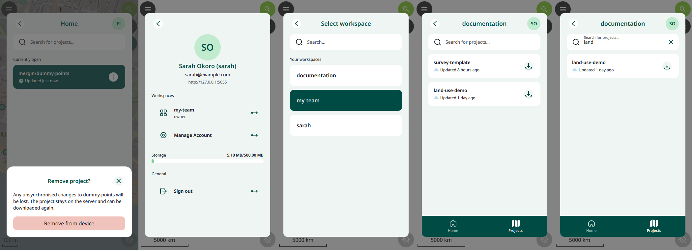
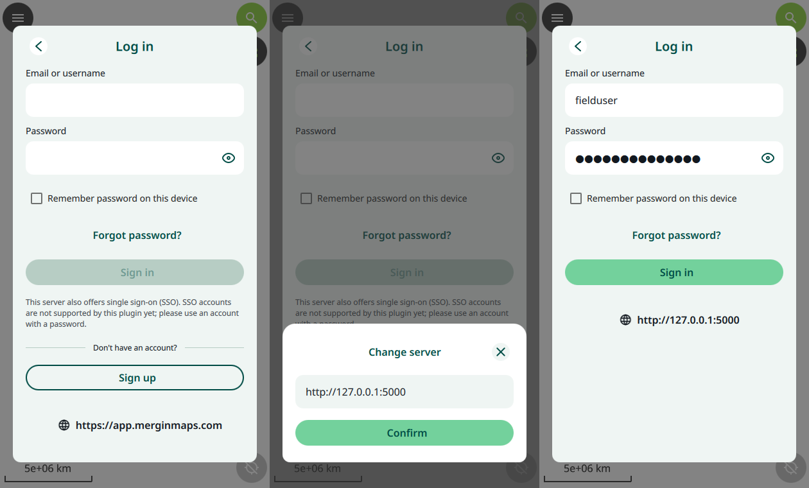

# Mergin Maps for QField

[](https://github.com/saberraz/qfield-plugin-merginmaps/actions/workflows/ci.yml)

A [QField](https://qfield.org) plugin that connects QField to [Mergin Maps](https://merginmaps.com). You can sign in to your Mergin Maps account, download your projects and collect data in QField. Edits are synchronised in both directions with the Mergin Maps server, and with colleagues using Mergin Maps mobile or the QGIS Mergin Maps plugin.



- Works with **app.merginmaps.com** (the default), **Enterprise Edition** and **Community Edition** servers.
- **Real Mergin Maps sync.** It uses Mergin's own [geodiff](https://github.com/MerginMaps/geodiff) library, compiled to JavaScript ([geodiff-js](https://github.com/saberraz/geodiff-js)). GeoPackage edits are merged feature by feature with edits made elsewhere, and conflicts are resolved the same way as in the other Mergin Maps apps.
- The screens follow Mergin Maps mobile: Home, Projects, the account page and workspace switching.
- A pure QML/JavaScript plugin: one install from a URL, with no separate app and no modified QField.

> **Status: prototype.** Sync is tested extensively (see [Tests](#tests)), but this is not yet an official Mergin Maps product. Keep a backup of important data and report problems in [Issues](https://github.com/saberraz/qfield-plugin-merginmaps/issues).

## Requirements

- **QField 4.3 or newer** on Android, iOS, Windows, macOS or Linux.
- A Mergin Maps account with a username (or email) and password. Single sign-on (SSO) accounts are [not supported yet](#limitations).

## Install


1. In QField, open the main menu (☰) and go to **Settings → General → Manage plugins**.
2. Tap **Install plugin from URL**, then either:
   - tap the **QR code button** in the URL field and scan the code on the right (QField starts the installation as soon as it reads it), or
   - enter the URL:
     ```
     https://github.com/saberraz/qfield-plugin-merginmaps/releases/latest/download/qfield-plugin-merginmaps.zip
     ```
3. When QField asks, allow the plugin to run.
4. A **Mergin Maps** button appears in the toolbar, on the map's side.

**Update:** install from the same URL again. The new version replaces the old one, and your account and projects are kept. **Uninstall:** **Manage plugins**, then uninstall *Mergin Maps*. Downloaded projects stay on the device and can be removed in QField's file manager.

To install a specific version, use the zip attached to that [release](https://github.com/saberraz/qfield-plugin-merginmaps/releases), for example `…/releases/download/v0.6.0/qfield-plugin-merginmaps-v0.6.0.zip`.

## Use

### Sign in
Tap the **Mergin Maps** toolbar button.



- Enter your **email or username** and **password** and tap **Sign in**.
- **No account yet?** Tap **Sign up** to create one on [app.merginmaps.com](https://app.merginmaps.com/register) in your browser, then come back and sign in. **Forgot password?** opens the server's password reset page.
- **Another server** (Enterprise or Community Edition): tap the server address at the bottom (the globe icon), enter your server's URL and **Confirm**. "Sign up" is shown only on servers that allow you to register yourself.
- **Remember password on this device** keeps you signed in when your session expires (every 12 hours by default). The password is then stored, unencrypted, in QField's settings. Leave it off on shared devices; you will be asked to sign in again when needed.

### Download a project
- The **Projects** tab lists the projects of your current workspace; its name is the title. Use the search field to filter.
- Tap the **download** button on a project. The files are downloaded and checked, then the project opens. Downloads use the network, so do this before you go into the field.

### Work offline, then synchronise
- Collect and edit data as usual in QField. No connection is needed.
- To synchronise, tap the round **sync** button that appears in the toolbar while a Mergin Maps project is open. The plugin then:
  1. downloads your colleagues' changes, merging their GeoPackage edits with yours feature by feature;
  2. uploads your changes, including new photos and other files.
- A banner shows progress. Keep QField open until "Successfully synchronised" appears. If anything fails (for example, no signal), nothing is lost: your edits stay on the device and you can sync again later.
- **Conflicts.** If you and a colleague changed the same attribute of the same feature, the server's version is kept and a `… (edit conflict, <you> vN).json` file records your values, as in the other Mergin Maps apps. A non-GeoPackage file changed on both sides is kept as `… (conflicted copy, <you> vN)`.

### Home: projects on this device
- **Home** lists downloaded projects. The open one is at the top, under "Currently open".
- Tap a project to open it.
- The **⋮** menu offers **Synchronise project** and **Remove from device**. Removing deletes the local copy and any unsynchronised changes; the project stays on the server.

### Workspaces and account
- Tap your **initials** (top right) to open your account: name, email, server, current workspace and role, storage used, **Manage Account** (opens the Mergin Maps dashboard) and **Sign out**.
- If you belong to several workspaces (app.merginmaps.com or Enterprise Edition), tap the workspace row and choose another workspace on **Select workspace**. The Projects tab then lists that workspace's projects. The plugin remembers your choice.

## Limitations

- **SSO accounts** can't sign in yet. Mergin Maps' SSO sign-in redirects to the Mergin Maps app, which a QField plugin cannot receive.
- **Deleting files.** QField only lets plugins delete project folders and media files. When a colleague deletes a GeoPackage or text file on the server, the plugin empties the local copy and records it so it is never uploaded again; the empty file stays on the device.
- **New files** are uploaded when QField recognises their type (data, images, audio, video, text). Files with other extensions are not detected; files that were already in the project always sync.
- **Large files** are held in memory while they download or upload. GeoPackages of several hundred MB may be too large on low-memory devices.
- Projects downloaded with plugin **0.4** still work but can't be removed with **Remove from device**.
- Each project gets its own folder: `QField/Created Projects/mm_<workspace>_<project>/`. That folder also contains a small helper project `mm_<workspace>_<project>.qgz`, which the plugin uses to release files during sync. Open the Mergin project through the plugin's Home tab.

## Troubleshooting

- **The plugin's log:** QField's main menu → **Message log**. Plugin messages start with `[Mergin]`.
- **"Failed to synchronise your changes: …"**: usually a connection problem. Your edits are kept; sync again when you're back online.
- **"Your session expired"**: sign in again (or tick "Remember password").
- Please include the `[Mergin]` log lines when you report a problem.

## How it works

The plugin is QML and JavaScript only (`plugin/`):

| File | Role |
|---|---|
| `qml/MerginClient.qml` | Server connection, sign in, session renewal, REST calls |
| `qml/MerginWorkspaces.qml` | Your workspaces and the active one |
| `qml/MerginProjects.qml` | Server project list, projects on this device, download, removal |
| `qml/MerginSync.qml` | Two-way sync (pull with rebase, then push), following the official `mergin-client` |
| `qml/GeodiffWorker.qml`, `js/geodiffworker.js`, `js/geodiff_inc.js` | geodiff (from [geodiff-js](https://github.com/saberraz/geodiff-js)) in a background thread |
| `qml/MerginPanel.qml`, `main.qml` | User interface |

Every GeoPackage keeps a base copy in `<project>/.mergin/`, as in the other Mergin Maps clients. Local edits are a geodiff changeset between the base and your copy. Each changeset is verified before upload: base + changeset must reproduce your file exactly. Files are backed up before a pull overwrites them and restored if anything fails. Developer notes are in [CLAUDE.md](CLAUDE.md).

## Tests

| Suite | Runs | Where |
|---|---|---|
| Unit tests (`tests/qml`) | Helpers, sync planning, geodiff worker vs native pygeodiff | CI on every push |
| Integration (`tests/qml`) | Sign in, session renewal, project listing, chunked downloads and workspaces against a real Mergin Maps CE server and a mock multi-workspace server | CI (podman) |
| End-to-end in real QField (`tests/qfield`) | QField 4.3.6 drives the actual UI. Covers sign in and sign up, Change server, download of 4 projects (including Unicode paths, chunked files and real QField samples), Home/Projects, Remove from device, account and workspace switching, and two-user sync: push, pull with rebase, conflicts, server down then recovery, and a file deleted on the server. Server and device copies are then checked independently | CI (Xvfb), screenshots kept as artifacts |
| geodiff-js | geodiff's C++ suite in Qt, differential fuzzing against native geodiff, robustness | [geodiff-js CI](https://github.com/saberraz/geodiff-js/actions) |

Running locally (Linux, podman, Qt 6.10.3 from `aqtinstall`, a Python with GDAL bindings and `mergin-client`, and the QField AppImage extracted to `$S/qfield-app/squashfs-root`):

```sh
tests/server/start_local_mergin.sh                        # throwaway Mergin CE on 127.0.0.1:5000 (WEB=1: dashboard on :8080)
PYTHON=<py> tests/server/prepare_test_projects.sh         # 2 real + 2 dummy projects
python3 -I tests/server/mock_multi_workspace.py &         # 3-workspace account on :5055
QML_XHR_ALLOW_FILE_READ=1 QT_QPA_PLATFORM=offscreen qmltestrunner -input tests/qml
Xvfb :99 -screen 0 540x960x24 &                           # or: Xwayland :99 -geometry 540x960
S=<work dir> PYTHON=<py> tests/qfield/run_e2e.sh workspaces_e2e   # also: auth_e2e, login_e2e, projects_e2e, sync_e2e
S=<work dir> NO_PLUGIN=1 tests/qfield/run_e2e.sh install_e2e      # installs the published release from its URL
```

Run `tests/server/reset_dummy_points.sh` before repeating `sync_e2e` on the same server.

## geodiff updates

`plugin/js/geodiff_inc.js` comes from a [geodiff-js release](https://github.com/saberraz/geodiff-js/releases). Its version and checksums are in `plugin/js/geodiff_inc.json`. Each day, [`update-geodiff.yml`](.github/workflows/update-geodiff.yml) checks for a newer release. If there is one, it verifies the checksums, runs the plugin's geodiff tests and opens a pull request (as a draft if the tests fail). CI then runs on the pull request's branch. In turn, geodiff-js builds and tests every new MerginMaps/geodiff release automatically.

## Releasing

Set `version` in `plugin/metadata.txt`, commit, then tag and push `v<version>`. [`release.yml`](.github/workflows/release.yml) attaches `qfield-plugin-merginmaps-v<version>.zip` and `qfield-plugin-merginmaps.zip`; the second is the one the install URL above points to.

## Licence

GPL-2.0-or-later ([LICENSE](LICENSE)), like QField and Mergin Maps mobile. Icons in `plugin/icons` come from [Mergin Maps mobile](https://github.com/MerginMaps/mobile) (GPL-2.0-or-later). geodiff-js is MIT and includes geodiff (MIT) and SQLite (public domain).
